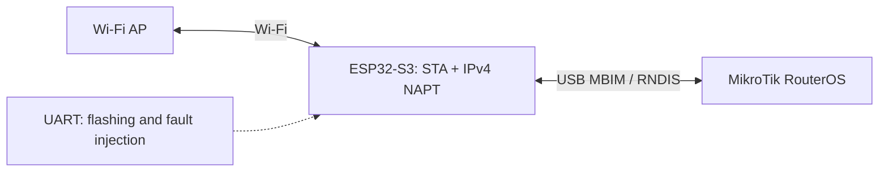

# MikroTik Modem Emulator

[Русский](README.md) · **English**

Wi-Fi-backed USB MBIM/RNDIS modem emulator on ESP32-S3 for MikroTik testbeds.

The ESP emulates a modem and access link. The SD-WAN controller stays on MikroTik.
Normal modem operation requires no additional APIs, HTTP endpoints or external
calls: RouterOS delivers the Wi-Fi profile through standard MBIM APN fields.

**Status: experimental firmware.** Core scenarios were tested on an isolated hEX
RB750Gr3 running RouterOS 7.11.2. Acceptance is incomplete: live cable hot-unplug
and end-to-end SD-WAN with the ESP remain open. The ESP has no cellular radio;
SIM, operator and LTE radio fields are emulated.



## Features and observed limitations

| Feature | Result |
|---|---|
| USB MBIM → actual RouterOS `lte1` | Verified |
| APN → Wi-Fi SSID/password | Automatic, including recovery after reset |
| ICMP and HTTP from the router through LTE | Verified |
| Native Network Scanner | Displays actual Wi-Fi SSIDs |
| LTE Monitor | Model, revision, SIM/operator and virtual cell/RF fields appear |
| Data blackhole with live USB, then recovery | Verified; local gateway remains reachable |
| CFUN 0/1 and invalid APN/SSID/key | Disconnection and recovery verified |
| Cold USB reconnection | Device disappearance, re-enumeration and internet recovery verified |
| Cell Monitor / SINR | Cell Monitor is Unsupported; SINR did not appear on the tested version |
| RNDIS / RNDIS+CDC | Additional profiles; current hardware acceptance applies to MBIM |

The hEX USB power reset did not detach the ESP while a separate UART cable supplied
power. That test was not counted as a successful hotplug. A separate 10-second
hardware EN reset proved cold USB reconnection. Live cable unplug/replug was not
tested. One earlier external ping test received 4/5 replies; no zero-loss or
long-term stability guarantee is claimed.

RSRP is a virtual value derived from Wi-Fi RSSI; cell identities derive from BSSID,
and the LTE band/EARFCN are virtual. RSRQ and the ATDS test SINR are synthetic.
These are not real LTE measurements or physical SD-WAN capacity benchmarks.
See the [validation summary](MODEM-SCANNER-VALIDATION.md).

## Profiles and hardware

- `mbim`: MBIM control + NTB16, IPv4 `192.0.2.2/32` via IPConfiguration; APN controls Wi-Fi.
- `hilink`: RNDIS, ESP-side DHCP, separate UART Wi-Fi configuration.
- `at`: RNDIS with experimental CDC ACM; AT-chat did not work on the tested RouterOS.

An ESP32-S3 with native USB is required. Connect native USB to MikroTik; a separate
USB–UART cable is used for flashing and test controls, not normal internet access.
The tested board had 16 MiB flash and 8 MiB PSRAM. The image uses no PSRAM and the
first 4 MiB flash layout with a 2 MiB app partition. USB is Full Speed.
IPv4 and WPA2 PSK/open networks are supported; WPA3-only, Enterprise/EAP and IPv6
are not implemented. The upstream Wi-Fi subnet must not overlap `192.0.2.0/24`.

## APN configuration

For RouterOS MBIM: `apn=wifi`, `user=SSID`, `password=Wi-Fi key`,
`authentication=pap`, `ip-type=ipv4`, `use-network-apn=no`.
The APN profile name is local to RouterOS. Route/DNS options are configured in APN.
ESP settings remain in RAM; RouterOS delivers the profile again after reboot.
Explicit `AT&W` saves the active profile in NVS and is never called automatically.

The [APN/Wi-Fi guide](APN-WIFI.md) contains synthetic examples.
For a separate UART connection:

```text
python tools/configure.py --port <ESP_UART_PORT> --ssid DemoAP
```

The key is entered through a hidden prompt, never argv. The helper checks ATI
before sending credentials and sets DTR/RTS=False before opening CH343 to avoid
an unintended ESP reset.

## Build and host checks

Prepared host: Linux/WSL Ubuntu 24.04, Python 3.12, GCC/gcov, Git, CMake and ESP-IDF
system prerequisites. Install `requirements.txt`. Independent decoding requires
`libmbim-glib4` or `MODEM_LIBMBIM_PATH`.

```sh
python3 -m pip install -r requirements.txt
python3 tools/check.py
python3 tools/check_usb.py
python3 -m unittest discover -s tests -p 'test_*.py' -v
python3 tests/mbim/check.py
python3 tests/mbim/check_driver.py
python3 tools/bootstrap.py
python3 tools/mirror_sdk.py
python3 tools/build.py --native-sdk --profile mbim
python3 tools/verify.py --profiles mbim
```

IDF 5.5.2, esp-usb and TinyUSB commits are pinned in `tools/build.py`.
SDK/toolchains are not bundled. Builds use one low-priority compiler job and are
deferred if an enclosing SD-WAN soak is active. Build commands never flash devices.
Artifacts retain the name `sdwan_esp32_lte` for continuity with the validated image.
The C sources match the hardware-tested build. Standalone packaging passed 14
Python tests, but a new native build of this packaging has not yet been repeated.
Host verification does not replace hardware acceptance.

Before the first write, identify the chip/flash, save a private full backup and
verify the layout and SHA256. Perform a separate verify-flash afterwards. Do not
change eFuse or erase original flash unnecessarily. Statistics are not periodically
persisted; SDK startup operations may still write flash.

## Reuse in QEMU CHR/x86

`components/modem` and `components/mbim` do not depend on ESP-IDF/TinyUSB. They can
be reused by a usbredir emulator through a thin C ABI/ctypes adapter. USB transport,
APN backend and IP/ARP need adaptation; ESP Wi-Fi/NAPT/NVS should stay on the ESP.
The QEMU MBIM adapter is **not implemented** in this repository yet.

[Portable core](docs/PORTABLE-CORE.md) · [migration plan](docs/QEMU-MBIM-PLAN.md).

## Published contents

Source, synthetic tests and de-identified documentation only. Real passwords,
SSID/BSSID values, owner configurations/identifiers, raw logs, screenshots, full
backups, RouterOS images/licenses and ELF files with local paths are excluded.
Test examples are not owner credentials. See [dependencies](THIRD_PARTY.md).
