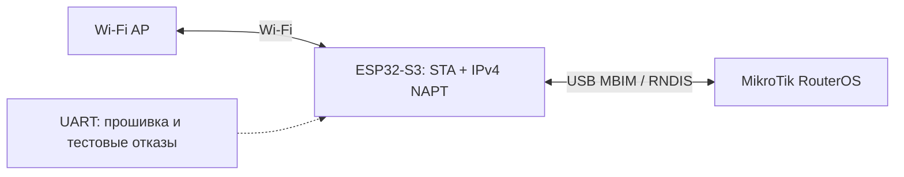

# MikroTik Modem Emulator

**Русский** · [English](README.en.md)

Эмулятор USB-модема MBIM/RNDIS на ESP32-S3 с выходом в интернет через Wi-Fi для стендов MikroTik.

*Wi-Fi-backed USB MBIM/RNDIS modem emulator on ESP32-S3 for MikroTik testbeds.*

ESP изображает модем и канал доступа. Контроллер SD-WAN выполняется на MikroTik.
Для штатной работы не нужны дополнительные API, HTTP-endpoints или внешние вызовы:
RouterOS передаёт Wi-Fi-профиль через стандартный MBIM APN.

**Статус: экспериментальная прошивка.** Основные сценарии проверены на отдельном
hEX RB750Gr3 с RouterOS 7.11.2. Полная приёмка ещё не завершена: горячее извлечение
кабеля и сквозной SD-WAN с ESP остаются открытыми. Сотовой радиочасти у ESP нет;
SIM, оператор и LTE-поля — эмуляция.



## Возможности и проверенные ограничения

| Возможность | Результат |
|---|---|
| USB MBIM → настоящий `lte1` | Проверено |
| APN → SSID/пароль Wi-Fi | Автоматически, включая восстановление после сброса |
| ICMP и HTTP через LTE с самого роутера | Проверено |
| Штатный Network Scanner | Показывает реальные Wi-Fi SSID |
| LTE Monitor | Модель, версия, SIM/оператор и виртуальные cell/RF-поля видны |
| Обрыв данных при живом USB и возврат | Проверено, локальный шлюз остаётся доступен |
| CFUN 0/1, неверный APN/SSID/пароль | Проверены отключение и восстановление |
| Холодное USB-переподключение | Исчезновение устройства, повторное обнаружение и интернет проверены |
| Cell Monitor / SINR | Cell Monitor возвращает Unsupported; SINR не отображается на тестовой версии |
| RNDIS / RNDIS+CDC | Дополнительные профили; текущая аппаратная приёмка относится к MBIM |

USB power reset на hEX при отдельном питании ESP через UART не вызвал отключения
устройства. Этот тест не засчитан как hotplug. Отдельный аппаратный сброс EN на
10 секунд подтвердил холодное USB-переподключение. Горячее извлечение кабеля не
проверено. В одном раннем внешнем ping-тесте было 4/5 ответов; гарантии отсутствия
потерь и длительной стабильности не заявляются.

RSRP отображает виртуальную величину на основе Wi-Fi RSSI; Cell ID/PCI выводятся
из BSSID, диапазон/EARFCN виртуальные. RSRQ и тестовый ATDS SINR синтетические.
Это не измерения настоящего LTE и не аппаратный тест производительности SD-WAN.
Подробнее: [результаты проверки](MODEM-SCANNER-VALIDATION.md).

## Профили и плата

- `mbim`: MBIM control + NTB16, IPv4 `192.0.2.2/32` через IPConfiguration, APN управляет Wi-Fi.
- `hilink`: RNDIS, DHCP от ESP, настройка Wi-Fi через отдельный UART.
- `at`: RNDIS с экспериментальным CDC ACM; AT-chat на проверенном RouterOS не заработал.

Нужен ESP32-S3 с native USB. USB подключается к MikroTik; отдельный USB–UART нужен
для прошивки и тестового управления, а не для штатного выхода в интернет.
Проверенная плата имела 16 MiB flash и 8 MiB PSRAM. Текущая сборка не использует
PSRAM, layout занимает первые 4 MiB, app partition — 2 MiB. USB ограничен Full Speed.
Поддержаны IPv4 и WPA2 PSK/открытые сети; WPA3-only, Enterprise/EAP и IPv6 не реализованы.
Wi-Fi upstream не должен пересекаться с `192.0.2.0/24`.

## APN и настройка

Для MBIM в RouterOS: `apn=wifi`, `user=SSID`, `password=Wi-Fi key`,
`authentication=pap`, `ip-type=ipv4`, `use-network-apn=no`.
Имя APN-профиля локально для RouterOS. Поля маршрута/DNS задаются через APN.
Настройки ESP остаются в RAM; после перезапуска RouterOS снова передаёт профиль.
Явный `AT&W` сохраняет профиль в NVS и автоматически не вызывается.

[Схема APN/Wi-Fi](APN-WIFI.md) содержит синтетические примеры.
Для отдельного UART подключения:

```text
python tools/configure.py --port <ESP_UART_PORT> --ssid DemoAP
```

Пароль вводится скрытым prompt, не через argv. Утилита проверяет ATI до передачи
credentials. Порт открывается с DTR/RTS=False, чтобы не сбрасывать ESP через CH343.

## Сборка и host-тесты

Подготовленный хост: Linux/WSL Ubuntu 24.04, Python 3.12, GCC/gcov, Git, CMake и
системные prerequisites ESP-IDF. Установите `requirements.txt`; для независимого
декодирования нужен `libmbim-glib4` либо `MODEM_LIBMBIM_PATH`.

```sh
python3 -m pip install -r requirements.txt
python3 tools/check.py
python3 tools/check_usb.py
python3 -m unittest discover -s tests -p 'test_*.py' -v
python3 tests/mbim/check.py
python3 tests/mbim/check_driver.py
python3 tools/bootstrap.py
python3 tools/mirror_sdk.py
python3 tools/build.py --native-sdk --profile mbim
python3 tools/verify.py --profiles mbim
```

IDF 5.5.2, esp-usb и TinyUSB закреплены по commit в `tools/build.py`.
SDK и toolchain не входят в репозиторий. Сборка однопоточная, с низким приоритетом;
если обнаружен активный соседний SD-WAN soak, она откладывается. Команды сборки
не прошивают устройство. Артефакты сохраняют имя `sdwan_esp32_lte` для совместимости
с проверенной прошивкой. Копии C-исходников совпадают с аппаратно проверенным build;
самостоятельная упаковка прошла 14 Python-тестов, но её новая native-сборка ещё не
повторялась. Host-проверка не заменяет проверку конкретной платы.

До первой записи определить чип/flash, сохранить приватный backup, сверить layout
и SHA256. После записи выполнить отдельную verify-flash. Не менять eFuse и не
стирать исходную flash без необходимости. Периодической записи статистики нет;
системные операции SDK при старте могут писать flash.

## Повторное использование в QEMU CHR/x86

`components/modem` и `components/mbim` не зависят от ESP-IDF/TinyUSB. Их можно
использовать в usbredir эмуляторе через небольшой C ABI/ctypes adapter. Нужно
адаптировать USB transport, APN backend и IP/ARP; Wi-Fi/NAPT/NVS из ESP не переносить.
QEMU MBIM adapter здесь **ещё не реализован**.

[Portable core](docs/PORTABLE-CORE.md) · [план переноса](docs/QEMU-MBIM-PLAN.md).

## Состав публикации

Только исходники, синтетические тесты и обезличенная документация. Пароли, реальные
SSID/BSSID, конфиги и идентификаторы владельца, raw-логи, скриншоты, полные backup,
RouterOS-образы/лицензии и ELF с локальными путями исключены. Данные для примеров
в тестах не являются пользовательскими credentials. [Зависимости](THIRD_PARTY.md).
